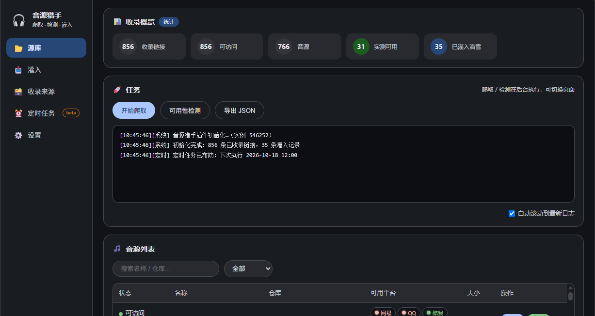
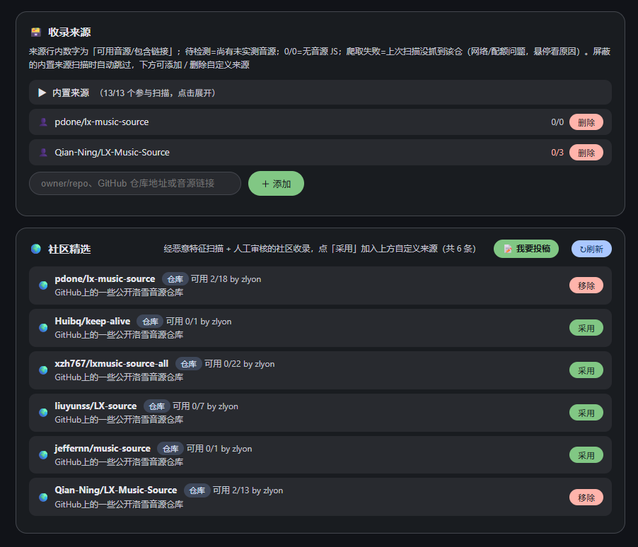
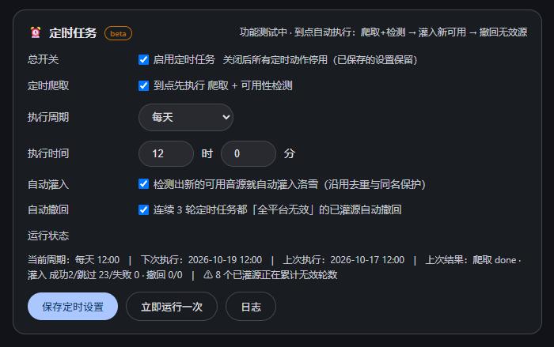

# 音源猎手 (LX Source Hunter)

Songloft JS 插件：GitHub 音源搜索、沙箱可用性检测、多选灌入洛雪音源插件并支持一键撤回。需要先安装洛雪音乐插件。


> 🐳 **非 Songloft 用户**可使用独立版 —— [lx-hub](https://github.com/zlyon/lx-hub)，Web 版音源聚合站，Docker 一条命令部署（镜像 `ghcr.io/zlyon/lx-hub`，支持 amd64/arm64），浏览器直接用。



## 功能

**源库**

- 搜索：扫描内置精选仓库 + 自定义来源，自动提取 `.js` 音源候选，自动去重入库
- 检测：基础探活 → 疑似音源识别 → jsenv 沙箱深度检测（真实测试歌曲逐平台发起 `musicUrl` 请求 → Range 探测 + 音频魔数校验，假链接/试听片段无法通过）
- 可疑标记：命中可疑特征的音源单独标注，悬浮查看命中原因

**灌入**

- 实测可用的音源列表，平台红绿灯（绿=可用 / 红=不可用 / 灰=未检测）
- 多选勾选 → 一键灌入洛雪音源插件并启用
- 一键撤回：调用洛雪插件的删除接口，移除本插件灌入的音源

**收录来源**

- 内置 13 个精选仓库（持续维护、长期更新的活跃音源仓），开箱即用；也支持添加自定义仓库、`.js` 直链、音源发布页
- **社区精选**：经恶意特征扫描 + 人工审核的社区收录，点「采用」一键加入自定义来源；也可以[投稿推荐](https://github.com/zlyon/lx-hunter-market/issues/new?template=source-submit.yml)你发现的音源仓库，审核通过后所有用户可见



**定时任务（beta）**

- 到点自动执行：搜索 + 可用性检测 → 灌入新可用源 → 撤回无效源，全程无需人工干预
- 执行周期灵活：每天 / 每 N 天 / 每 N 小时 / 每周 / 每月，精确到分钟
- 自动撤回仅对「连续 3 轮全平台无效」的已灌源生效，不误删
- 运行状态实时可见：下次执行时间、上次执行结果、失效源计数；支持「立即运行一次」和完整执行日志
- 启用前需配置 GitHub Token（见下文）



**设置**

- 搜索代理 / raw 加速镜像（可选 jsDelivr 加速）/ 深度检测开关与单轮上限
- 仓库管理：内置仓库锁定，自定义仓库支持直接粘贴 GitHub 地址

## 安装

**方式一：插件商店（推荐）**

Songloft → 设置 → JS 插件管理 → 插件商店 → 管理订阅源 → 添加：

```
https://raw.githubusercontent.com/zlyon/lx-hunter/main/registry.json
```

**方式二：手动上传**

从 [Releases](https://github.com/zlyon/lx-hunter/releases) 下载 `lx-hunter-vX.Y.Z.jsplugin.zip`，在 Songloft 插件管理页上传。

## 使用流程

1. 「设置」页按需配置代理/镜像和自定义仓库
2. 「收录来源」确认内置仓库与社区精选，按需添加自定义来源
3. 「源库」点「开始搜索」→ 自动完成 搜索 → 基础检测 → 深度检测（一轮需几分钟）
4. 「灌入」页勾选想要的可用源 →「灌入所选」
5. 音源失效后：深度检测复跑 →「灌入」页勾选失效项 →「撤回所选」；或在「定时任务」开启自动灌入/自动撤回，彻底放手

## GitHub Token 配置（推荐）

GitHub API 未认证限额仅 **60 次/小时**，限额耗尽后本轮搜索会全部失败。在插件「设置 → 网络 → GitHub Token」填入一个 Personal Access Token，限额即刻提升到 **5000 次/小时**（约 80 倍），多轮搜索、频繁复检更从容。**定时任务必须配置 Token 才能启用**。


**获取步骤（1 分钟）**：

1. 登录 GitHub，打开 [Token 创建页](https://github.com/settings/tokens/new)
2. Note 随意填（如 `lx-hunter`），Expiration 有效期选长一点
3. **权限一项都不用勾**——此 token 仅用于提升 API 限额，读取的都是公开数据，无任何写权限
4. 点 **Generate token**，复制生成的 `ghp_...` 字符串
5. 粘贴到插件「设置 → 网络 → GitHub Token」输入框，保存即可

> 留空则保持未认证限额不变；token 只保存在你自己的 Songloft 服务端，不会上传到任何第三方。

## 注意事项

- 需要宿主已安装「洛雪音源」(lxmusic) 插件，灌入/撤回才能生效
- 权限仅申请 `storage` + `jsenv`
- 未认证 GitHub API 限速 60 次/小时（深度检测不受影响）；在「设置」页配置 GitHub Token 可提升至 5000 次/小时，见上方「GitHub Token 配置」
- 插件与洛雪音源插件互相独立，卸载互不影响

## 反馈

遇到问题请到 [Issues](https://github.com/zlyon/lx-hunter/issues/new?template=bug_report.yml) 提交。**不需要填写任何技术细节**，两步即可：

1. **导出配置** —— 设置 → 检测 → 点「导出配置」，按钮会把插件版本、运行环境、各项开关一次性打包并**自动隐去 GitHub Token、代理密码等敏感信息**，直接粘贴到模板里即可。
2. **贴日志** —— 复现一次问题后，把「源库」页日志区的内容复制过来（出问题**前后 30~50 行**，含开头的 `[时间][模块]` 前缀）。日志同样已自动脱敏，其中 `**` 就是被隐去的敏感内容。

洛雪音源插件是否安装、问题出现在哪一步，插件会自己带上或可从日志直接看出，无需手动判断。

> ⚠️ 请不要手动把 GitHub Token 贴进来——它等同于账号凭据。
